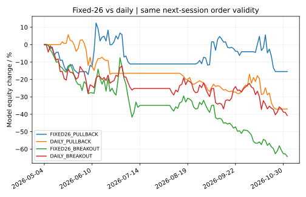
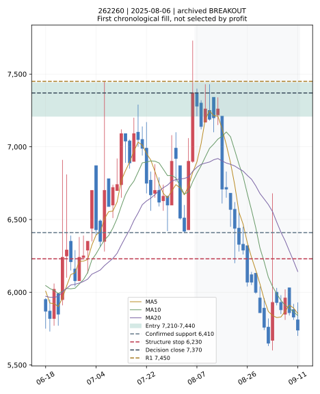

# C3 매일 선정·눌림목·돌파 비교 — 2026-11-05

**현재 판단: CASH. 실전 채택 없음.** 종목명·매수가·허용 범위·손절·1·2차 저항을 현재 추천 가격으로 발표하지 않는다. 두 연구 후보(삼성SDI 006400, 나노신소재 121600)는 기술적 구조 관측일 뿐 검증된 TOP2가 아니다.

| 최종 항목 | 결과 |
|---|---|
| TOP1 / TOP2 | 미선정 / 미선정 |
| 매수가·범위·구조손절·저항 | 검증된 추천 가격 없음 |
| 5·10·20거래일 전망 | 새 미사용 기간 검증 불충분 |
| 매수 여부 | **CASH** |

## 같은 조건의 네 실험

2026-05-04~2026-11-03의 재사용 비교 구간. 95종목, 최대 두 자리·동일 자금·동일 선정 순위. 매수 0.15%, 매도 0.50%, 매수·매도 슬리피지 각 0.10%를 차감한 가상 모형이다. 완료 표본은 종목 수가 아닌 거래 수이며 기간별 보유·재선정 경로가 달라 단순 합산하지 않는다.

| 방식 | 완료 5/10/20 | 5일 평균 | 10일 평균 | 20일 평균 | 20일 종가평가 MDD | 20일 주문→체결 |
|---|---:|---:|---:|---:|---:|---:|
| 26일 간격 · 눌림목 | 10/10/6 | +8.32% | +4.68% | -1.02% | -24.79% | 41→8 (19.5%) |
| 매일 재평가 · 눌림목 | 16/11/9 | -3.63% | -3.21% | -10.29% | -40.43% | 54→10 (18.5%) |
| 26일 간격 · 돌파 확인 | 18/14/9 | -4.69% | -7.11% | -17.86% | -64.33% | 18→11 (61.1%) |
| 매일 재평가 · 돌파 확인 | 20/15/8 | -4.53% | -12.68% | -10.62% | -40.76% | 12→9 (75.0%) |

MDD는 각 20일 보유 모형의 전체 일별 자산 곡선이다. 미만기 손실·현금·수수료·미체결 예약을 반영하며 장중 최대낙폭이나 실제 계좌 성과를 인증하지 않는다. 표의 평균은 거래당 평균으로 자산 곡선 수익률과 다르다. 순서는 고정된 네 조합이며 최고 수익 조합을 사후 선정하지 않았다.

26일 눌림목의 5일 +8.32%, 10일 +4.68%는 양수지만 각 10건뿐이고 20일은 -1.02%다. 매일 눌림목으로 바꾸면 5·10·20일이 모두 음수다. 돌파는 다음 시가에서 더 자주 체결됐으나 수익성이 개선되지 않았다. 개발 구간 20일 돌파 성과는 고정 +2.50%, 매일 +6.55%였으나 재사용 비교 구간에서는 각각 -17.86%, -10.62%로 반전됐다. 미사용 검증 성공으로 볼 수 없다.

## 실제 변경

- `c3_daily_top2_v4.py`: 고정 26일 / 매일 갱신 × 눌림목 / 돌파 확인 네 조합만 추가했다. 기존 12개 타점·8개 청산 실험은 재계산하지 않았다.
- 선정: 완료 일봉의 상승 추세·20일 상대강도 양수 후 20일 실제 거래대금 순위. 시장 대용지수가 하락 추세일 때 신규 진입을 막는다. 뉴스·실적·수급의 추가 지표는 만들지 않았다. 시장 대용지수는 기존 111종목 바스켓이며 실제 코스피·코스닥 지수가 아니다.
- 26일은 보유기간이 아닌 동일 종목의 제안 간격이다. 선택되지 않은 유효 제안도 기존 방식처럼 시계를 예약한다. 두 방식 모두 주문은 다음 한 거래일만 유효하다. 이전 v3의 5일 관찰 주문과 수치가 직접 같아야 하는 실험은 아니다.
- 매일 방식은 미체결 후 다음 완료 일봉에서 다시 제안한다. 같은 종목 중복 보유·두 자리 초과·같은 지지 구조 재매수는 금지한다. 실제 체결 전에는 그 구조를 소비하지 않는다.
- 눌림목: 확인 지지 +0.25~1 ATR 가격 구간, 알려진 1차 저항 아래로 상단을 제한한다. 지정가 한 번 접촉은 체결로 단정하지 않고 시가가 구간 내이거나 한 호가 아래 실제 거래가 있어야 모형 체결한다.
- 돌파: 이전 20일 고점 위 종가·양봉·기존 거래량 대비 1.2배를 확인하고 다음 시가에서 고정된 가격 구간 안에 있을 때만 모형 진입한다. 신호 당일 종가에 산 것으로 계산하지 않는다.
- 손절: 좌우 2개 일봉으로 확인된 저점에서 먼저 정한다. 확인일 ATR의 0.5배 완충을 고정하고 호가 단위로 내림한다. 변동성 확대를 이유로 기존 손절을 내리지 않는다. 고정 -3/-5/-8%, 손절 위 3%, 강제 1R 조건은 쓰지 않는다.
- 종가 이탈과 시간 청산은 다음 거래 가능한 시가로 모델링한다. 갭·거래정지·기업행위 불확실성을 별도 처리하며 매수와 장중 손절 동시 접촉은 순서 불확실성으로 남긴다. 목표가 도달을 실제 익절로 가정하지 않는다.
- `c3_daily_report_v4.py`: 전체 현재 가격 코드의 원본 해시·수집 시각·종목 유형·자료 연속성 가능 여부를 검사하고 CASH JSON, 모바일 HTML, 구조 차트를 만든다. 최신 업종·종목 유형을 과거 선정에 소급 적용하지 않는다.

## 데이터와 미사용 검증

- 원본: 2025-05-02~2026-11-03, 2,909코드·1,012,593일봉·366거래 관측일. 공식 정규장 전용 범위, 공식 거래일 인증, 기업행위 확정 및 생존자 편향 제거는 미완료다. 관측 시장 일자에 내부 공백은 없지만 공식 거래소 캘린더 인증과 같지 않다.
- 비바이오 분류 가능한 기존 111종목에서 과거 규칙 설계 16종목을 제외한 95종목만 손익을 비교했다. **전체 시장 수익모델 검증 완료가 아니다.** 소급 테마 분류·시장 바스켓의 편향이 남아 있다.
- 최신 실제 가격 날짜: **2026-11-04**, 2,769코드. 65개 유효 과거 일봉 확보 가능 2,424코드. 현재 업종·사업 범위 미확인 2,345코드는 순위에서 제외했다. 현물 보통주 여부 미확인·특수 유형 161개, 제약·바이오 제외 152개는 서로 다른 최종 제외 사유다.
- 최신 종목 기본정보 날짜는 2026-11-03이다. 실제 자료 확인 시각은 2026-11-05T05:45:46.276756+00:00 (한국시간 2026-11-05 14:45:46). 11월 4일 당일 또는 11월 5일 시가 전에 자료가 도착했다고 소급 주장하지 않는다. 과거 일봉의 다음 날 시가 전 공급 가능성도 인증되지 않아 체결 가정으로 남긴다.
- 3월 말 개발 종료·4월 격리·5월 이후 비교를 유지했다. 그 비교 기간은 이전 연구에서 이미 보았으므로 새 기간 외 검증으로 부르지 않는다.
- 새 미사용 구간은 **2026-11-06 이후 결정**부터 분리했다. 현재 5·10·20일 완료 표본은 모두 **0**으로 평균·MDD는 미검증(null)이다. 별도 예약·자동 수집·실전 승인 기능은 만들지 않았다. 실제 다음 시가 전에 신호를 등록한 기록과 이후 충분한 일봉이 필요하다.

## 실패 원인과 다음 최소 과제

1. 거래대금·상대강도 순위와 매일 재제안만으로는 수익성 향상이 없었다. 20일 매일 눌림목 손절 비율은 7/9건(77.8%)이다.
2. 돌파 확인은 더 비싼 진입과 긴 구조손절 거리, 가까운 저항을 해결하지 못했다. 첫 과거 차트 사례는 저항까지 비용 차감 여유가 음수다. 이 관측을 사후 필터로 덧붙여 같은 기간을 다시 최적화하지 않았다.
3. 26일 눌림목의 짧은 기간 양수는 적은 표본·기간 의존성이 크다. 20일 신뢰구간은 모두 표본·월별 군집 부족으로 계산하지 않았다.
4. 가격 2,769개 점검을 전 종목 비바이오 후보 선별 완료로 해석할 수 없다. 다음 과제는 신뢰 가능한 업종 범위와 정규장 가격 인증을 채우고, 고정한 네 조합을 미사용 시점에서 기록해 비교하는 것이다.

## 재현과 보존

기존 PR 커밋 `74c2aa932f7b389621ea8db66ee32d7ef16079cc` 및 513개 성공 기록을 그대로 보존했다. 이전 문서·코드·원장은 변경하지 않았다. 신규 19개 테스트는 로컬 통과했다. 전체 532개 회귀 및 원본 ZIP 해시·CSV·현재 JSON 재현은 연구 전용 GitHub Actions에서 한 번 검증한다. 실제 원격 결과는 별도 `validation_summary.json`에 기록한다. 새 워크플로에는 예약 실행이 없고 주문·알림·기본 브랜치를 바꾸지 않는다.

[실험 입력](../reports/c3_work4_20261105/inputs.json) · [비교 CSV](../reports/c3_work4_20261105/daily_comparison.csv) · [상세 JSON](../reports/c3_work4_20261105/daily_report.json) · [현재 CASH](../reports/c3_work4_20261105/current_decision.json) · [모바일 보고서](../reports/c3_work4_20261105/mobile_report.html)

전체 원장과 전체 시장 감사 CSV는 새 `c3-daily-top2-v4` CI 산출물에 보관한다. 원본은 입력 JSON의 세 고정 ZIP 및 SHA-256으로 재현한다. 잘린 임시 CSV 두 개는 입력과 커밋에서 제외했다.

