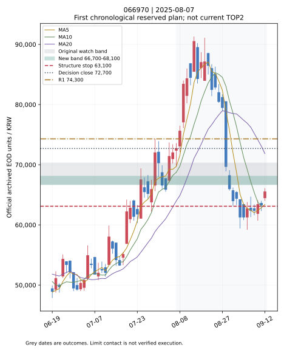
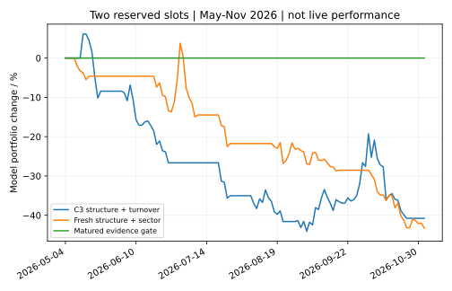

# C3 TOP2 실전 판단 중심 3차 연구 — 2026-11-05 KST

**현재 행동은 CASH다. 수익성이 확인된 종목 선정·매수가·구조손절 조합은 발견하지 못했다.**

## 현재 TOP2 / CASH

| 구분 | TOP1 | TOP2 |
|---|---|---|
| 종목명·코드 | 선정 없음 | 선정 없음 |
| 선정 이유 | 검증된 종목·타점 조합 부재 | 동일 |
| 매수 관찰가 | 미제시 | 미제시 |
| 1차 매수가 | 미제시 | 미제시 |
| 매수 허용 범위 | 미제시 | 미제시 |
| 구조적 손절가 | 미제시 | 미제시 |
| 손절까지 거리 | 미제시 | 미제시 |
| 1차 저항가 | 미제시 | 미제시 |
| 2차 저항가 | 미제시 | 미제시 |
| 5거래일 전망 | 미검증 | 미검증 |
| 10거래일 전망 | 미검증 | 미검증 |
| 20거래일 전망 | 미검증 | 미검증 |
| 매수 판단 | **CASH** | **CASH** |

오늘 오전 완료된 전체 시장 실행도 실제 선정 자료는 **2026-11-03** 기준이다. 요청한 완료일 11월 4일과 다르다. 실행 시각을 가격 날짜로 바꾸지 않았다. 11월 4일 공식 응답 확인은 이번 CI에서 두 번의 읽기 전용 요청으로 별도 기록한다. 새 일별 가격이 제공되어도 11월 3일의 수급·선정 자료와 무조건 합치지 않는다.

현재 재사용한 전체 시장 기록은 2,768코드, 유동성 확인 보통주 295개, 최근 5일 외국인·기관 합산 순매수 134개다. 정규장 범위·과거 업종·실적·주요 뉴스의 당시 확인 여부와 최종 성과 기준이 미완료이므로 현재 매수 가격과 점수를 만들지 않았다.

## 실제 수행한 작업

- `C3_checkpoint_20261105_1202.zip`의 현재 파일 정보와 로컬 보존본을 확인했다. 미반영 코드가 없고 잘린 CSV 한 개가 기존 커밋 자료의 앞부분과 동일하다. 이 사본은 연구 입력으로 쓰지 않았다.
- 기존 489개 성공 기록과 12개 타점·8개 청산 비교를 재사용했다. 기존 12개 전체 backtest는 이 연구 엔진에서 다시 실행하지 않았다.
- 새 코드 `c3_practical_top2_v3.py`는 같은 의사결정일에서 세 가지 매수 규칙과 거래대금·종목 상대강도·업종 주도 순위를 비교한다. 현재 분류의 업종을 과거에 사용했다는 편향은 표시하며, 당시 알 수 없었던 뉴스·재무·수급은 점수에 넣지 않는다.
- 손절 구조를 먼저 고정하고 매수가 상한만 낮춘다. 최근 확인 저점에 ATR 완충을 둔 방식도 별도로 비교한다. -3/-5/-8% 고정 손절, 손절 위 3% 매수 제한, 고정 8% 위험 예산은 강제하지 않았다.
- KRX 보통주 호가 단위에 맞춰 매수 상한과 구조손절 표시값을 내림 처리한다. 지정가에 한 번 닿은 사실을 체결로 확정하지 않고 시가 진입 또는 지정가보다 한 호가 아래 거래가 관측된 경우를 보수적 체결 모형으로 쓴다. 주문 대기열·실제 체결은 여전히 미확인이다.
- 최대 두 종목만 예약·보유하고 대기 자금을 예약한다. 미래 미체결을 미리 알아 빈자리를 채우지 않는다. 정수 주식 수, 비용·슬리피지, 미만기 손실의 평가금액, 다음 거래 가능한 시가와 정지·갭을 반영한다.
- 최근 성과 확인 장치는 과거 조기 손절 거래도 원래의 동일 평가 기간이 완성될 때까지 증거에 넣지 않는다. 현금 거래 0건을 수익 모델 성공으로 집계하지 않는다.
- 현재 판단 JSON, 모바일 보고서, 과거 차트와 일별 모형 포트폴리오 곡선을 생성했다. 신규 인과·체결·현금·가격 날짜 검사 24개를 로컬에서 통과했다. 전체 회귀 결과는 이 커밋의 연구 CI와 PR 본문에 기록한다.

## 검증 범위와 공정 비교의 한계

공식 가격 원본은 2025-05-02~2026-11-03, 2,909코드·1,012,593일봉이다. 전략 집단은 비바이오로 분류 가능한 111종목이고 이전 규칙 설계에 쓰인 16개를 제외한 **95개**를 이번 선택 비교에 사용했다. 생존자·사후 업종 선정 편향은 제거되지 않았다. 이전에 이미 본 검증 기간이므로 새로운 미사용 기간 외 검증이라고 주장하지 않는다.

개발은 2026-03-31까지, 4월 격리, 비교 구간은 5월 이후다. 이전 C3 구조의 고정 결정일을 공통 입력으로 써 매수가·순위의 효과를 통제했다. **실제 과거 C3의 뉴스·재무·수급 점수와 TOP2 순위를 완전히 복원한 결과는 아니다.** 원래 결정일의 종목별 26거래일 간격도 남아 있어 실전 매일 재선정의 인증은 아니다.

초기 모형자금 1,000만원, 두 자리, 레버리지 없음. 이는 사용자 계좌 자금이 아니다. 매수 비용 0.15%, 매도 비용 0.50%, 슬리피지 각 0.10%이며 정수 수량을 사용한다. 기간 청산과 종가 손절은 다음 거래 가능한 시가다. MDD는 비용을 반영한 일별 종가 평가금액 기준이며 실제 장중 최대낙폭이 아니다. 미만기 포지션의 손실도 포트폴리오 평가금액에 포함하지만 완료 거래 평균에는 넣지 않았다.

## 종목 선정·매수가·손절 비교 결과

완료 표본은 5/10/20일 순서다. 수익률은 실제 계좌 성과가 아닌 비용 차감 가상 체결 모형이며 모든 모형을 실전 미채택했다.

| 모형 | 완료 5/10/20 | 5일 평균 | 10일 평균 | 20일 평균 | 20일 운용 포트폴리오 변화 | 종가 평가 MDD | 20일 지정가 모형 체결률 |
|---|---:|---:|---:|---:|---:|---:|---:|
| 기존 구조 / 거래대금순 | 19/15/11 | -5.07% | -7.05% | -6.85% | -40.77% | -47.32% | 61.90% |
| 기존 구조 / 종목 상대강도순 | 17/15/12 | -2.88% | -7.75% | -9.20% | -45.75% | -45.91% | 54.17% |
| 기존 구조 / 업종·주도주순 | 16/14/12 | -5.03% | -7.85% | -9.20% | -45.75% | -45.91% | 54.17% |
| 비용 반영 매수가 상한 / 거래대금순 | 16/14/11 | -4.56% | -6.16% | -8.84% | -52.14% | -59.59% | 48.39% |
| 비용 반영 매수가 상한 / 종목 상대강도순 | 16/14/12 | -4.35% | -8.02% | -10.30% | -47.29% | -48.14% | 44.44% |
| 비용 반영 매수가 상한 / 업종·주도주순 | 15/14/10 | -2.14% | -6.66% | -8.91% | -42.03% | -47.10% | 46.15% |
| 최근 지지점·매수가 상한 / 거래대금순 | 9/9/6 | -4.25% | -7.30% | -10.43% | -38.72% | -42.45% | 28.12% |
| 최근 지지점·매수가 상한 / 종목 상대강도순 | 8/8/5 | -8.38% | -9.28% | -10.63% | -39.94% | -45.39% | 28.57% |
| 최근 지지점·매수가 상한 / 업종·주도주순 | 9/9/5 | -7.25% | -8.61% | -12.99% | -43.31% | -45.37% | 29.63% |
| 최근 지지점·매수가 상한 / 업종·주도주순 / 성과 확인 | 0/0/0 | 미검증 | 미검증 | 미검증 | +0.00% | +0.00% | 거래 없음 |

거래대금순 C3 구조 비교 기준의 20일 완료 11건은 승률 18.18%, 평균 이익 +21.90%, 평균 손실 -13.24%, 손익 합계 비율 0.37, 손절 실행률 81.82%다. 새로운 선정 순위를 붙여도 수익성 개선은 확인되지 않았다. 업종·주도주 순위는 상대 순위의 효과를 보기 위한 모형이며 강세 업종의 미래 성과를 인증한 점수가 아니다.

개발 구간의 기존 구조+거래대금순 20일 평균은 +5.53%였지만 비교 구간에서 -6.85%로 뒤집혔다. 최근 지지점+업종 순위도 개발 +1.80%에서 -12.99%로 뒤집혔다. 더 높은 개발 수익률을 이유로 선택하지 않았다. 완료 표본과 월별 묶음이 적어 신뢰구간 대부분은 산출 불충분으로 남겼다. 시장 강세·횡보·약세별 건수와 평균 이익·손실·손익비는 `top2_report.json`에 저장했다.

최근 성과 확인 장치는 검증 구간에서 거래가 0건이다. 현금 포트폴리오 변화 0%, MDD 0%를 수익성 개선으로 취급하지 않는다. 표본·조건 충족 부족 또는 최근 성과 불량으로 거래를 막은 안전성 실험이며 실제 수익 모델은 아니다.

## 좋은 가격만 기다리는 문제

같은 관측 기간을 모두 완료한 **143개 공통 결정일**에서 미체결을 현금 0으로 포함한 기회당 평균은 기존 구조 -2.53%, 매수가 상한 -0.94%, 최근 지지·상한 -0.88%였다. 이는 자금 운용 포트폴리오 수익률이 아니다.

모형 체결은 각각 75→45→32건으로 감소했고, 매수가 상한은 기존 이익 사례 4건, 최근 지지·상한은 8건을 놓쳤다. 체결된 교집합의 손익비가 좋아진 사실만으로 실용적 개선으로 판단할 수 없다. 두 자리 운용에서는 선택된 종목과 미체결 기회가 달라져 개선이 유지되지 않았다.

첫 번째로 예약한 과거 계획을 차트로 골랐다. 수익이나 체결 여부로 사례를 고르지 않았다. 현재 기준 가격은 제시하지 않고 해당 과거 의사결정일의 공식 원본 종가·매수 범위·구조손절·알려진 저항·MA5/10/20만 표시했다. 두 번째 저항이 없으면 만들지 않는다. 이 차트는 현재 추천이 아니다.

## 아직 하지 않은 작업과 다음 가설

1. 미체결 후에도 종목별 26일을 기다리는 실험 시계 대신, 5일 관찰 만료 뒤 새 완료 일봉으로 재평가하고 동일 구조는 중복 집계하지 않는 일별 TOP2를 새 기간에서 비교한다. 보유·대기 자금은 계속 두 자리로 제한한다.
2. 지정가를 낮추는 방식과, 처음 돌파가 확인된 경우 다음 시가에 변동성 예산 내에서 진입하는 방식의 기회 비용을 비교한다. 기존 MA·거래량 조건의 실패를 숨기거나 조합을 사후 최적화하지 않는다.
3. 현재 가격 경계 9건과 정규장 범위, 당시 업종·상장 이력을 인증한 뒤 미사용 기간에 검증한다. 그 전에는 뉴스·수급·실적에 임의의 점수를 부여하지 않는다.

실행하지 않은 위 항목을 완료로 보고하지 않는다. 실전 주문·알림·예약 설정·기본 브랜치를 변경하지 않았고 PR #30은 초안 유지다.

입력 해시와 원본 실행은 [inputs.json](../reports/c3_work3_20261105/inputs.json), 수익률은 [CSV](../reports/c3_work3_20261105/top2_comparison.csv), 상세 통계는 [JSON](../reports/c3_work3_20261105/top2_report.json), 모바일 자료는 [HTML](../reports/c3_work3_20261105/mobile_report.html)에 있다. 전체 선정·거래·일별 평가 원장은 이 커밋의 `c3-practical-top2-v3` 연구 산출물로 보관한다.

호가 단위 근거: [KRX 유가증권시장](https://regulation.krx.co.kr/contents/RGL/03/03010100/RGL03010100T3.jsp), [KRX 코스닥시장](https://regulation.krx.co.kr/contents/RGL/03/03020100/RGL03020100.jsp). 통계 페이지의 거래량·거래대금은 정규장 전용으로 자동 인증하지 않는다.
