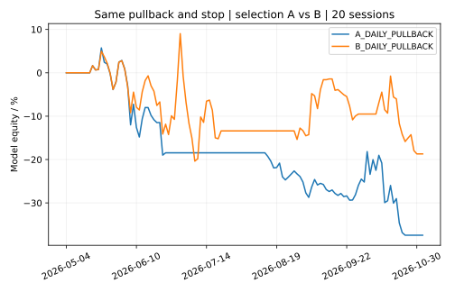

# C3 6차 — 종목 선정 능력 우선 검증

**현재 행동: CASH. B에서 일부 손실 축소는 확인했지만, 수익성·기간 안정성·신규 미사용 검증을 충족하지 못해 실전 채택하지 않았다.** 기존 558개 검증과 과거 보고서를 보존했다.

## A. 선정 능력 개선 결과

같은 기존 95종목·같은 의사결정 당시 완료 일봉·같은 거래대금 순위를 사용했다. A는 기존 추세·상대강도 선정, B는 그 후보에서 자기 시장(KOSPI/KOSDAQ) 대비 20일 상대강도가 양수이고 최근 5일 동안 개선된 종목만 남긴 사전 가설이다. 업종까지 포함한 전체 B는 과거 시점별 업종 자료 부족으로 검증하지 않았다. 현재 확인한 1,983종목 범위로 과거 95종목 결과를 확대 해석하지 않는다.

사전 규칙은 실행 전 GitHub 커밋 `5d41b9c380cba7cc3004a0e4de0fbce800b45edc`에 고정했다. 결과를 본 뒤 조합·임계값을 재선택하지 않았다. 개발은 2026-03-31까지, 4월 격리, 비교는 2026-05-01~11-03이다. 이 비교 기간은 이전에 보았으므로 새로운 기간 외 검증이 아니다.

동일 종목의 관찰 수익률이 겹치지 않도록 20거래일 간격으로 평가했다. 매일 TOP2의 원래 관측은 A 162개·B 150개지만 통계에 쓰는 비중복 관측은 각각 28개·46개다. 기간이 겹치지 않아도 시계열·시장 상관은 남아 있어 독립 표본이라고 주장하지 않는다.

| 선정 방식 | 완료 5/10/20 | 5일 지수 대비 | 10일 | 20일 |
|---|---:|---:|---:|---:|
| A 기존 · 매일 | 28/27/24 | -2.90%p | -6.00%p | -12.96%p |
| B 가격/상대강도 · 매일 | 46/44/38 | -1.16%p | -2.52%p | -4.07%p |

이 표는 **네이버 제공 KOSPI·KOSDAQ 지수값**을 사용했다. 각 366개 날짜·중복·OHLC·원본 해시를 검증했으나 KRX 직접 원본과의 독립 대조는 미완료다. 이전 -6.88%p는 동일가중 대용지수·겹치는 관찰 기준의 보존 결과다. 새 표는 지수와 표본 기준이 달라 그 숫자를 직접 대체하지 않는다. 신호일 종가를 매수가로 가정한 표도 아니다.

A/B 둘 다 관측된 같은 의사결정일만 맞추면 B-A 지수 대비 차이는 5일 **-0.62%p(17일)**, 10일 **+2.35%p(17일)**, 20일 **+5.39%p(15일)**다. 한쪽만 선택한 날짜를 0% 수익으로 채우지 않았다. 5일에는 같은 날짜 비교가 악화됐고 표본도 작아 전 기간 개선으로 승인하지 않는다.

B의 개발 구간 5/10/20일 지수 대비 평균은 +2.55/+3.12/+2.02%p였으나 비교 구간에서는 모두 음수로 반전했다. 개발에서 좋아 보이던 조건의 재사용 구간 유지 실패를 확인했다.

### 개별 요소 — 매일 선정의 20일 결과

| 추가 요소 | 완료 표본 | 20일 지수 대비 | 판단 |
|---|---:|---:|---|
| 자기 시장 상승 국면만 | 13 | -14.53%p | 탐색 결과·채택 없음 |
| 자기 시장 상대강도 양수 | 24 | -12.02%p | 탐색 결과·채택 없음 |
| 상대강도 개선 | 35 | -3.77%p | 탐색 결과·채택 없음 |
| 60일 추세 확인 | 21 | -9.84%p | 탐색 결과·채택 없음 |
| 252개 이력 확보 통제군 | 21 | -11.97%p | 동일 가용 이력 통제군 |
| 252일 고점 80% 이상 | 15 | -2.73%p | 탐색 결과·채택 없음 |
| 거래대금 5일/20일 확대 | 29 | -8.84%p | 탐색 결과·채택 없음 |
| 거래량 5일/20일 확대 | 29 | -9.41%p | 탐색 결과·채택 없음 |
| 확인 저점 상승 구조 | 29 | -9.11%p | 탐색 결과·채택 없음 |

모든 요소의 5·10·20일·승률·손실률·국면별 결과는 JSON/CSV에 있다. 252거래일 고점은 52주 고점의 근사이며 이력이 부족하면 추정하지 않는다. 252일 조건은 개발 구간 완료 표본이 0이므로 유망 전략으로 확정할 수 없다. 시장 상승 국면만 추가해도 성과가 나아지지 않았다. 현재 업종 강도·업종 주도주, 외국인/기관 수급, 당시 공시된 실적·뉴스는 과거 시점 증거가 없어 미검증이다. 현재 업종을 소급해 과거 성과를 개선하지 않았다.

### 선정과 진입의 분리

기존 v4의 눌림목/돌파 확인·확인 저점/ATR 고정 구조손절·한 거래일 주문 유효기간·두 자리 자금 예약을 그대로 재사용했다. 새 타점 기법은 추가하지 않았다. 먼저 TOP2를 고르고 진입 조건이 없으면 다음 순위 종목으로 미래를 보고 대체하지 않는다. 새 비교의 보유기간은 진입을 포함한 H개 세션 뒤 다음 시가이며 v4 경로 함수에 H-1을 넣어 맞췄다. 과거 v4의 별도 기간 관례와 수치를 수정하지 않았다.

| 매일 눌림목 · 비용 차감 모형 | 완료 5/10/20 | 5일 평균 | 10일 | 20일 | 20일 MDD |
|---|---:|---:|---:|---:|---:|
| A 기존 선정 | 17/13/9 | -3.11% | -5.64% | -10.40% | -40.84% |
| B 상대강도 개선 | 11/10/6 | -2.08% | -0.19% | -3.88% | -26.96% |

MDD는 미만기 손실·현금·수수료를 포함한 일별 모형 자산 기준이다. 실제 계좌·장중 MDD나 지정가 대기열 체결의 인증은 아니다. B 매일 눌림목의 20일 지정가 모형 체결률은 **9.09%**, A는 **17.54%**다. B는 적은 체결 표본 6개에서 손실과 낙폭이 줄었지만 놓치는 기회가 늘었다. 26일 간격 눌림목의 B 20일 손익은 -13.25%로 A -3.33%보다 나빴다. 돌파 매수도 수익성 개선을 일관되게 보이지 않았다.

B 매일 눌림목 20일 완료 6개 중 구조손절까지 1 ATR 이하 1개, 1~2 ATR 5개다. 후자의 평균 손절 거리는 매수가 대비 15.67%, 평균 손익 -9.08%, 손절률 60%였다. 1 ATR 이하 1개 결과로 촘촘한 손절의 우월성을 단정할 수 없다. 임의의 -3/-5/-8% 또는 손절 위 3% 제한은 도입하지 않았다. 첫 저항의 비용 차감 여유·미체결 상승 사례·손절 발생은 별도 통계로 남겼다. 종가 이탈 시 실제 다음 거래 가능 시가를 사용해 갭 하락이 손절가보다 나쁜 체결로 반영된다.

### 외부 AI 방식 A/B/C

TradingAgents의 분석/반론/위험 검토 분리와 AI Hedge Fund의 정보 공개일 제한·기록 구조를 검토했다. 외부 코드를 복사하거나 프레임워크를 설치·실행하지 않았다. 두 프로젝트의 미국 주식 연구 수익을 C3 성과로 가져오지 않았다.

- A: 실행 완료. 기존 Python 정량 선정.
- B: 가격·자기 시장 상대강도·개선 속도 부분 실행 완료. 과거 업종을 포함한 전체 B는 미검증.
- C: 익명 수치 입력·원본 해시·근거 필드·시각 검사 인터페이스만 구현. 실제 시점 고정 AI 응답이 없으므로 **실험 미실행·AI 효과 미검증**. 종목명·과거 날짜·사후 수익률·미래 뉴스는 검토 입력에서 제외한다. 모델 자체의 학습 지식에 의한 오염 제거도 아직 실증하지 못했다.

공식 Financial Datasets 요금 확인 결과 기본 크레딧은 $20/1,000요청, Personal은 $200/월·100,000요청이며 모델 API 비용은 별도다. **실제 가입·결제·유료 API 호출은 0, 발생 비용 $0**이다. 로컬 Ollama는 외부 모델 API 키 없이 가능한 대안이지만 현재 실행 파일·모델이 없어 사용하지 않았다. 무료 정량 파이프라인과 현재 확보한 자료를 유지한다. 출처와 고정 커밋은 [외부 연구 검토](../reports/c3_work6_20261105/external_ai_review.json)에 있다.

## B. 실제 실행 판단

| 항목 | TOP1 | TOP2 |
|---|---|---|
| 종목명·코드 | 미선정 | 미선정 |
| 선정 이유 | 수익성·신규 기간 검증 불충분 | 같은 이유 |
| 현재 기준 종가 | 종목 미선정으로 미제시 | 미제시 |
| 매수 관찰가 | 미제시 | 미제시 |
| 실제 매수 범위 | 미제시 | 미제시 |
| 구조손절가 | 승인 가격 없음 | 승인 가격 없음 |
| 손절까지 거리 | 해당 없음 | 해당 없음 |
| 1차·2차 저항가 | 미제시 | 미제시 |
| 5·10·20일 전망 | 신규 기간 미검증 | 신규 기간 미검증 |
| 최종 행동 | **CASH** | **CASH** |

11월 6일부터의 새 결정은 시점 보존 도구를 통해 등록하고 실제 5·10·20일이 끝난 뒤 평가해야 한다. 현재 완료 표본은 모두 0이다. 자동 예약을 만들거나 유료 모델을 호출하지 않았다. 새 연구 CI에서 11월 5일 공식 가격을 두 번의 시장 조회로 확인하되, 가격 확인만으로 새 선정 모델을 승인하지 않는다. 현재 1,983개 범위의 새로운 수익성 검증은 미완료다.

## C. 모바일 차트

[모바일 보고서](../reports/c3_work6_20261105/mobile_report.html)에 같은 눌림목·같은 손절의 A/B 자산 곡선과 최초 과거 구조 예시를 넣었다. 예시는 수익이 좋은 종목을 고른 것이 아니며 현재 추천이 아니다. 현재 TOP2가 없어 현재 종목 차트·가격을 만들지 않았다.

## D. 개발·검증

기존 연구 코드의 계산을 변경하지 않고 새 선정 비교·모바일 보고서·테스트·예약 없는 연구 CI만 추가했다. 신규 18개 단위 테스트는 로컬 통과했다. 전체 576개 회귀·원본 해시·CSV 원격 재현의 실제 결과는 완료 후 검증 증거에 기록한다. 연구 브랜치·PR #30 초안을 유지하고 실전 주문·기존 알림·예약·기본 브랜치는 변경하지 않았다.

[사전 프로토콜](../reports/c3_work6_20261105/protocol.json) · [요소별 CSV](../reports/c3_work6_20261105/factor_comparison.csv) · [가상 매매 CSV](../reports/c3_work6_20261105/paper_comparison.csv) · [전체 통계 JSON](../reports/c3_work6_20261105/factor_report.json) · [입력 해시](../reports/c3_work6_20261105/inputs.json)
