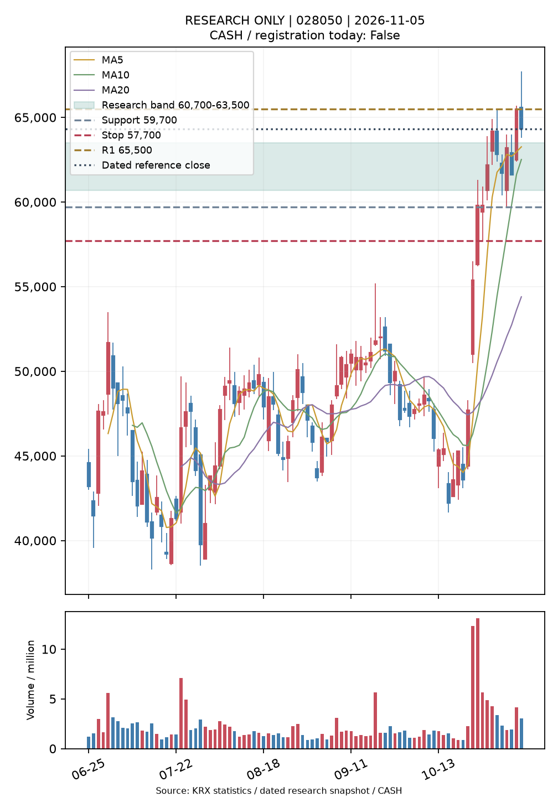
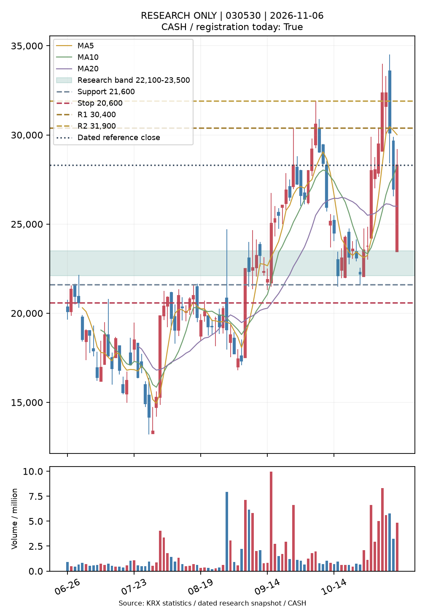

# C3 연구용 TOP2·가상매매 일일 통합 보고

- 보고일(KST): 2026-11-06 / 실행: 42219249335
- 확보된 가격 기준일: 미확보 / 수집: 미확보
- 분석 완료 시각: None / 보고 생성: 2026-11-06T12:39:33.613251+00:00
- 보고 실행: 42219249335 / 가격 원본 실행: 42219249335
- 데이터 상태: UNAVAILABLE / 원천: None / 정규장 전용 독립 인증: False
- 출처: 한국거래소 통계정보. FinanceData KRX 캐시 이용 시 동일 KRX 원천의 별도 전달 경로이며 독립 가격 공급사가 아닙니다.
- 마지막 확인 가격: 2026-11-04 / 오늘 등록된 결정: False
- 신규 신호: 0 / 신규 고유 종목: 0
- 실전 행동: CASH / 실제 브로커 주문·체결 0

오늘 등록되지 않은 아래 후보는 이전 확인일의 연구 미리보기이며 현재 매수 지시가 아닙니다.

## 삼성E&A 028050

|항목|값|
|---|---|
|종목|삼성E&A 028050|
|기준 거래일|2026-11-04|
|기준 종가|65,500원|
|선정 근거|시장 대비 RS20 +54.43%p · 5일 RS 개선 +13.30%p|
|매수 관찰가|63,500원|
|연구 매수 범위|60,700원~63,500원|
|구조손절가|57,700원|
|손절 거리(범위 상단)|9.13%|
|1차 저항|미확인|
|2차 저항|미확인|
|실전 행동|CASH|

## 원익홀딩스 030530

|항목|값|
|---|---|
|종목|원익홀딩스 030530|
|기준 거래일|2026-11-04|
|기준 종가|30,100원|
|선정 근거|시장 대비 RS20 +20.65%p · 5일 RS 개선 +9.00%p|
|매수 관찰가|23,500원|
|연구 매수 범위|22,100원~23,500원|
|구조손절가|20,600원|
|손절 거리(범위 상단)|12.34%|
|1차 저항|30,400원|
|2차 저항|31,900원|
|실전 행동|CASH|

## 신규 연구 성과

- 보존된 선정 기록: 0개. A/B는 별도 비교하며 같은 종목을 합쳐 독립 거래 수로 제시하지 않습니다.
- 선정 성과: 결정 종가→5/10/20일 종가와 자기 시장 지수 초과수익. 같은 종목의 20세션 중복 관찰 제외.
- 타점 성과: 기존 진입 조건·1세션 유효·보수적 접촉/체결 구분·비용과 슬리피지·종가 손절 뒤 다음 거래 가능 시가.
- 조기 청산 손익과 관찰기간 완료 여부를 분리하고, 청산 뒤에도 해당 종목의 관측을 계속합니다.
- A 선정 5일 완료 0개 / 지수 대비 평균 미확정
- A 선정 10일 완료 0개 / 지수 대비 평균 미확정
- A 선정 20일 완료 0개 / 지수 대비 평균 미확정
- B 선정 5일 완료 0개 / 지수 대비 평균 미확정
- B 선정 10일 완료 0개 / 지수 대비 평균 미확정
- B 선정 20일 완료 0개 / 지수 대비 평균 미확정

## B 후보의 가상매매 성과

- 지지 지정가 · 5일: 완료 0개 / 순손익 미확정 / 손절 종료 0개 / 상태 {}
- 지지 지정가 · 10일: 완료 0개 / 순손익 미확정 / 손절 종료 0개 / 상태 {}
- 지지 지정가 · 20일: 완료 0개 / 순손익 미확정 / 손절 종료 0개 / 상태 {}
- 눌림 확인 다음 시가 · 5일: 완료 0개 / 순손익 미확정 / 손절 종료 0개 / 상태 {}
- 눌림 확인 다음 시가 · 10일: 완료 0개 / 순손익 미확정 / 손절 종료 0개 / 상태 {}
- 눌림 확인 다음 시가 · 20일: 완료 0개 / 순손익 미확정 / 손절 종료 0개 / 상태 {}
- 돌파 제한 매수 · 5일: 완료 0개 / 순손익 미확정 / 손절 종료 0개 / 상태 {}
- 돌파 제한 매수 · 10일: 완료 0개 / 순손익 미확정 / 손절 종료 0개 / 상태 {}
- 돌파 제한 매수 · 20일: 완료 0개 / 순손익 미확정 / 손절 종료 0개 / 상태 {}

상태가 비어 있으면 등록 신호 자체가 0개입니다. NO_SIGNAL은 진입 조건 미성립, DAY_EXPIRED_NO_TOUCH는 지정가 미접촉 만료, TOUCH_WITHOUT_TRADE_THROUGH는 보수적 체결 미확인, DATA_UNUSABLE은 데이터 누락입니다. 가상 진입은 브로커 체결이 아닙니다.

## 수집·실행 상태

- UNAVAILABLE

- 운영 호출 검증 상태: MAIN_AUTOMATIC_EVENT_OBSERVED
- 기본 브랜치 호출 관측: True / 실제 자동 이벤트 관측: True / schedule 실행 관측: False
연구 브랜치 검증·기본 브랜치 호출·schedule 실행·ChatGPT 알림 전달은 각각 별도 증거로 확인합니다. 현재 ChatGPT 알림의 일정·활성 상태는 변경하지 않았으며 실제 전달은 미확인입니다.
실전 승인 TOP2 없음. GPT 실행·유료 API·실계좌 주문 없음.

- 호출: approved_daily / 원본 이벤트: workflow_run / 실제 자동 이벤트 관측: True
- 완료 일봉 확인 대상: 2026-11-06 / 같은 원본 중복 갱신 생략: False
- 직접 공식 API 상태: OFFICIAL_MARKETS_NOT_COMPLETE
- 가격 원장: lanes/krx_unadjusted_v12 (원본 암호화 보관, 기존 원장 보존). 캐시와 공식 API는 최종 KRX 원천을 공유하며 독립 공급사 둘로 계산하지 않습니다.
- 캐시 경로 공표 점검: NO_POSTCLOSE_FILE_PROOF (공식 장애 복구 성공이나 새 가격 검증을 뜻하지 않음).
- 기존 원본 복호화 검사: 1개 / bootstrap 3개. 키 값 출력 없음.
- 기존 스캐너 실제 수집 단계·아티팩트 확인: 42214603333

## 격리한 임시 연구 자료

- PROVISIONAL: 2026-11-06 / 2625종목 / 최종 수집 2026-11-06T12:36:40.269997+00:00
- pykrx→NAVER 수정주가 요청의 종가 영수증만 보관했습니다. 완전한 OHLC·실제 거래대금·정규장 범위는 미검증입니다.
- 공식 OHLC·신호 원장·가상 체결·인증 성과에 섞지 않습니다. 신규 TOP2가 아닙니다.
